<div align="center">

# 烧屏测试控制中心（AgingTestSystem）

**显示屏"高温通电老化"车间上位机 · 72 工位一屏管控 · .NET Framework WinForms**


一屏看住 **72 台真空负压表 + 72 路真空阀 + 72 路载台电源**，外加冷却送风机与扫码枪，
串起 **上料 → 抽真空 → 上电老化 → 下料判定 → 追溯** 的生产闭环。
Mock 与真机一键切换，不接线也能演示全流程。

</div>

---

## 界面速览

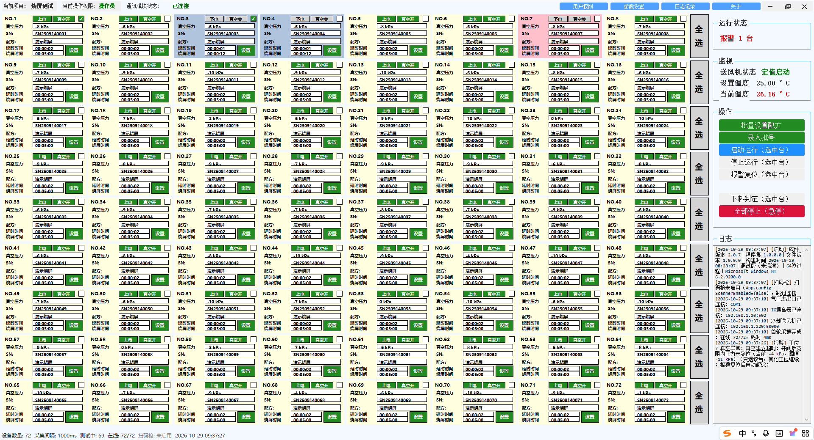

| 登录（三级权限） | 录入批号 |
| --- | --- |
| 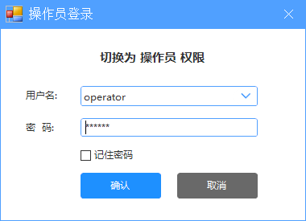 | 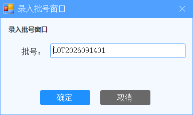 |
| **工位 ↔ SN 绑定（扫码自动填充）** | **批量设置配方** |
| 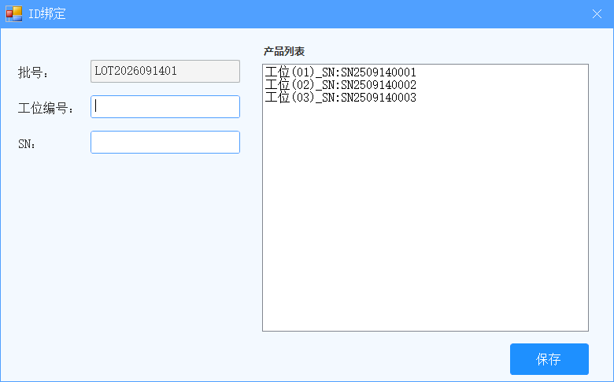 | 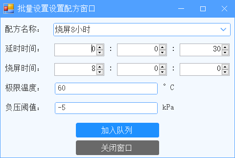 |
| **单台工位设置（点哪台开哪台）** | **配方管理** |
| 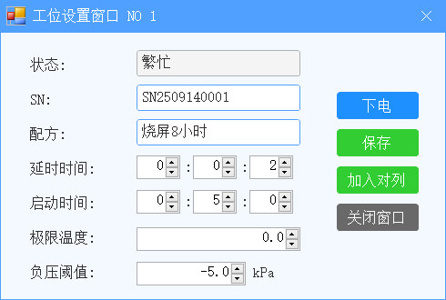 | 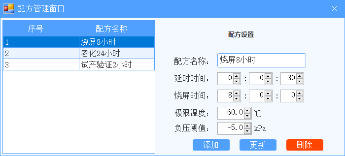 |
| **工艺策略画布（点节点改配置）** | **系统设置** |
| 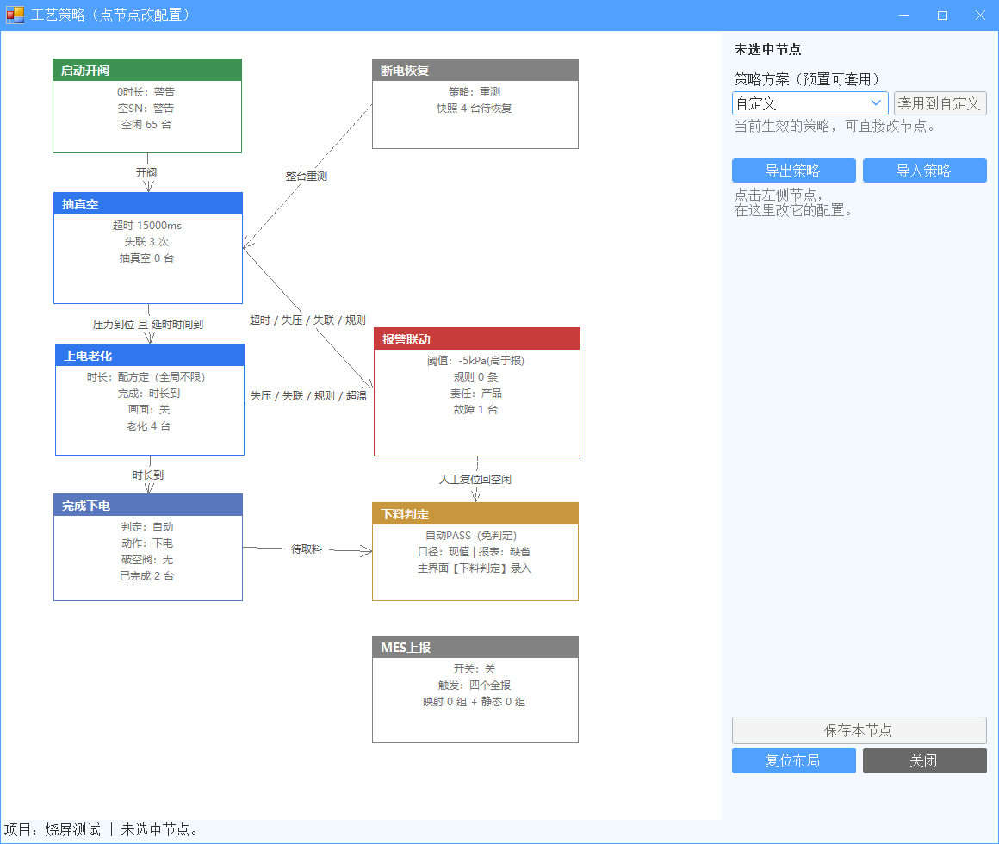 | 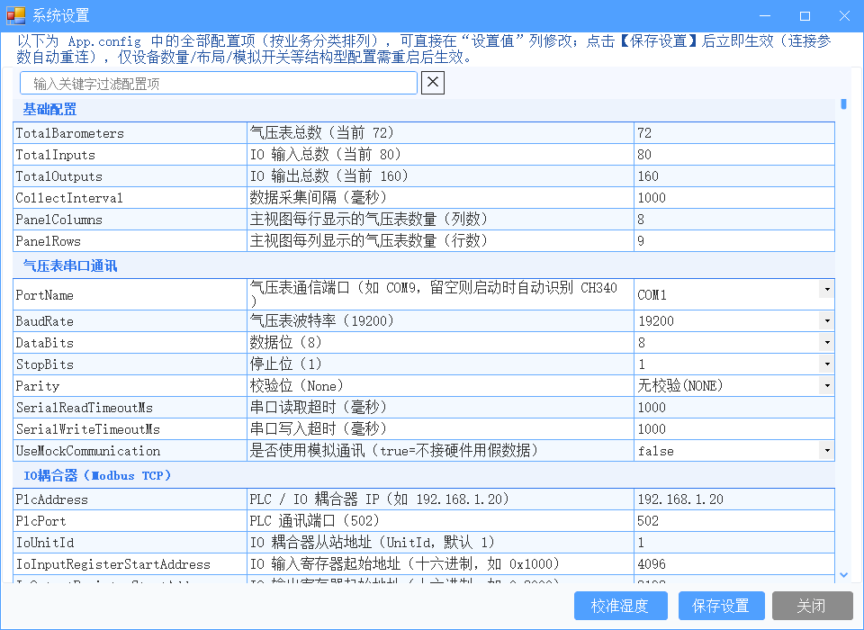 |
| **历史记录与报表** | **下料判定** |
| 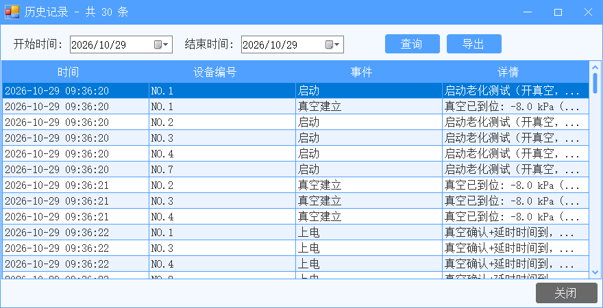 | 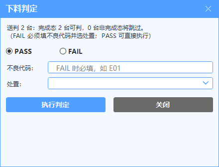 |
| **公共参数（批量写设备阈值）** | **项目切换（换工艺即换档案）** |
|  | 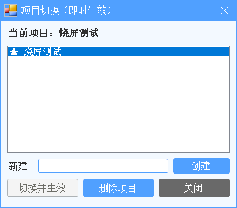 |
| **通讯测试（IO 点灯 / 一键遍历）** | **备用通道可视化连线** |
| 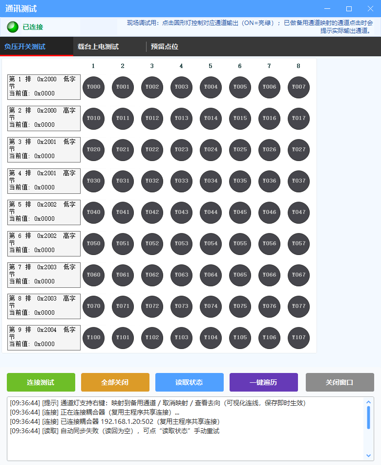 | 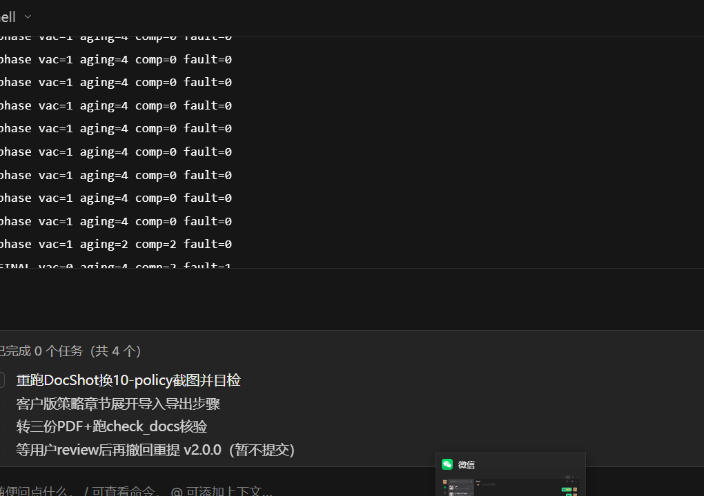 |
| **送风机测试** | **温度定点校准（长按温度值）** |
| 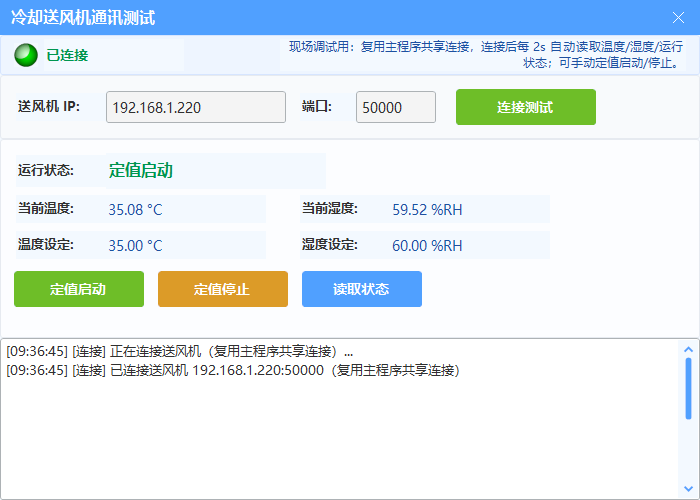 | 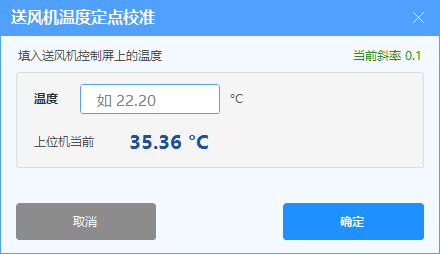 |
| **用户管理** | **软件授权** |
| 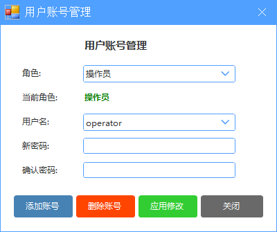 |  |

---

## 核心能力

- **三阶段老化状态机**：开阀抽真空 →（真空到位 ＋ 延时到，双条件满足）自动上电计时 →
  到时下电关阀 → "已完成·待取料"；完成口径可切"自动 PASS / 待判定人工录 PASS/FAIL"。
- **报警只提醒，不祸及全厂**：压力越限 / 真空建立失败 / 通讯失联 / DI 触点（可选），
  边沿触发只退故障那一台（关阀＋断电＋标故障），其余 71 台继续老化；
  超温 / 真空两路独立蜂鸣器，听声即可分辨事故类别。
- **送风机共用生命周期**：72 台共用一台风机，任一台在测或有未复位报警都保持送风
  （炉子还在发热，不停风），急停例外；温度/湿度定点比例可客户自助校准，不找开发改代码。
- **工艺策略驾驶舱**：固定拓扑画布，点节点改配置；预置 A 常用 / B 标准 / C 宽松 / D 严格 ＋ 自定义，
  套用即生效、跟项目走（切项目即换工艺，无需重启）。
- **规则引擎**：自定义报警规则（13 变量沙盒表达式，只能加严）＋ 完成表达式（只能提前）＋
  跳过抽真空（机械夹具产线）；变量含电流 `current`（电表到货即插即用）。
- **追溯与对接**：测试事件 CSV 落盘、历史查询按报表列导出 xlsx；MES 上报
  （触发器/字段映射/静态字段可配，失败重试＋离线缓存，永不阻断生产）；断电恢复快照，重启续跑。
- **72 站一屏自适应**：双向缩放精确铺满，无滚动条；小屏跟随缩小不挤叠；深浅双主题。

---

## 快速开始

```powershell
# 1. 拉代码
git clone https://github.com/lq700212/AgingTestSystem.git
cd AgingTestSystem

# 2. 构建（VS 自带 MSBuild；找不到先定位：
#    Get-ChildItem 'C:\Program Files*\Microsoft Visual Studio' -Recurse -Filter MSBuild.exe | Select -First 1）
& "D:\Program Files\Microsoft Visual Studio\18\Enterprise\MSBuild\Current\Bin\MSBuild.exe" `
  AgingTestSystem/AgingTestSystem.csproj /p:Configuration=Debug /p:Platform=AnyCPU /t:Build /nologo /v:m

# 3. 运行
.\AgingTestSystem\bin\Debug\烧屏测试控制中心.exe

# 4. 不接线先跑通全流程：App.config 里 UseMockCommunication = true
#    接现场真机改回 false —— 只改配置，不改代码
```

改配置不用翻文件：管理员登录 → 关于 → 设置，全部配置项分业务分类存表格里
（悬停有说明），保存即生效；仅设备数量等结构型配置需重启。

---

## 账号与权限（三级角色 ＋ 隐藏 dev）

| 账号 | 角色 | 权限 |
| --- | --- | --- |
| `operator` | 操作员 | 启动/停止/批号/绑定/下料判定/历史查询 |
| `technician` | 技术员 | ＋配方/公共参数/工艺策略/通讯测试/送风机测试 |
| `admin` | 管理员 | ＋系统设置/项目切换/用户管理/报表列配置 |
| `dev`（隐藏入口） | 最高权限 | 顶栏"管理员"登录框输入（初始码由交付方当面提供），界面无任何提示；可删改业务管理员、看深浅切换项；dev 名不可注册/不可删（防交付锁死） |

- 预置初始密码由交付方当面提供（PBKDF2 哈希存储，明文不落盘，细节见内部文档），**上线必改**；
- 任意已登录角色可改自己密码（用户权限 → 修改密码）。

---

## 设备与协议

| 设备 | 数量 | 协议 / 接入 |
| --- | --- | --- |
| 真空负压表（气压表） | 72 | Modbus RTU，RS485→CH340 USB，19200 8N1，从站 1~72 |
| IO 耦合器 | 1 | GX-CL140，Modbus TCP `192.168.1.20:502`，80DI/160DO |
| 冷却送风机 | 1 | 厂商控制屏，Modbus TCP 端口 50000，定值启停 ＋ 温湿度监视 |
| 扫码枪 | 1 | Honeywell Xenon 1902 虚拟串口 115200，WMI 自动识别串口 |

协议、寄存器、IO 映射与坑点全在 [`docs/通讯接入.md`](docs/通讯接入.md)（唯一协议文档）。

---

## 架构（一图看懂）

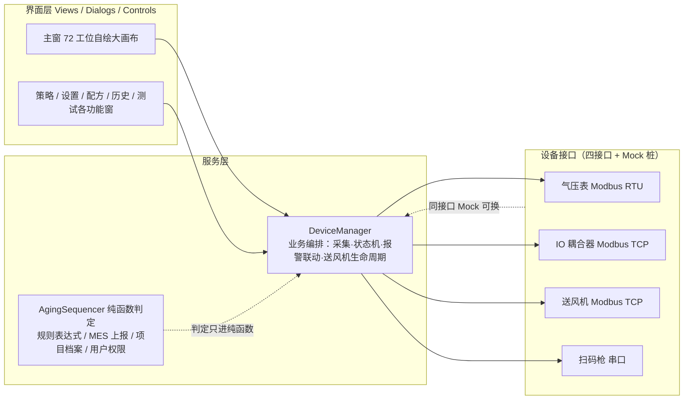

- 四设备接口（`IBarometerReader` / `IIoController` / `IFanController` / `IPowerMeter`），
  Mock 与真机同接口互换，`UseMockCommunication` 一个开关切换；
- 老化时序的"判定类"逻辑全部沉淀在 `AgingSequencer` 纯函数（2500＋试回归可直接断言），
  `DeviceManager` 只做"调用决策 ＋ IO ＋ 日志"。

---

## 文档导航

| 手册 | 内容 |
| --- | --- |
| [车间操作员使用说明](docs/车间操作员使用说明.md) | 开机 → 生产 → 报警处理（真实截图，另有同名 PDF） |
| [客户技术工艺使用说明](docs/客户技术工艺使用说明.md) | 换型 / 配方 / 排障 / 授权（客户口径，另有 PDF） |
| [内部培训文档](docs/内部培训文档.md) | 内部交付 / 权限 / 排障清单（另有 PDF） |
| [二次开发指导手册](docs/二次开发指导手册.md) | 架构 / 通讯 / 画布 / 业务子系统（开发新人从 0 到 1） |
| [通讯接入](docs/通讯接入.md) | 协议 / 寄存器 / IO 映射 / 坑点（**唯一协议文档**） |
| [AGENTS.md](AGENTS.md) | 改代码前必读的约定与红线 |
| [CHANGELOG.md](CHANGELOG.md) | 版本改动历史（唯一出处，最新在前） |

---

## 运维速记

- **日志三件套**（`Logs\` 下，按日期分文件）：`TestLog_*.csv`（测试事件，历史记录窗读它）、
  `AppLog_*.log`（UI 操作）、`Crash_*.log`（一崩一文件，含全堆栈——客户报障发这个）；
  主窗启动首行即"版本水印"（版本/构建时间/混淆标记），远程排障先看这行定版本。
- **一键回归**：`powershell -ExecutionPolicy Bypass -File .opencode\skills\agingtest-regression\scripts\build_and_test.ps1`
  （构建 → 真机冒烟 → 全量回归断言；新用例一律沉淀进 `tests/TestRunner.cs`）。
- **软件激活**：与 HJVision 同源同口径（CPU 序列号 ＋ MD5 码，同一套《获取激活码》工具通用），
  30 天/永久两档，不阻断生产；现场一键激活 `tools/auto_activate.bat`（随维护人员走，不发客户）。
- **发版**：走一键脚本 `obfuscated_release.ps1`（构建 → 混淆 → 组包 → 验收；
  产物含 mapping ＋ exe MD5 ＋ pdb ＋ 版本水印，缺一不可）。
- **运行时文件不入库**：配方/工位设置/策略跟项目走（`Projects/<项目>/`），
  用户/快照/日志/激活文件跟机器，都已 gitignore。
